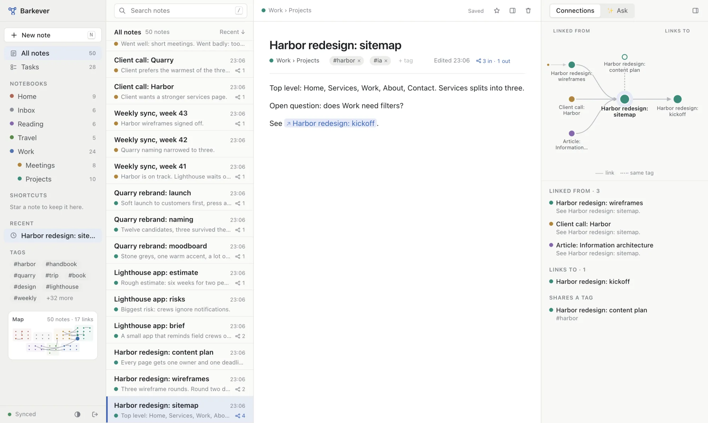

# Barkever

<picture>
  <source media="(prefers-color-scheme: dark)" srcset="docs/img/hero-dark.webp">
  
</picture>

**Notes and projects for visual thinkers.** Three calm panes on the web and on the Mac. It works offline, syncs when you're back, and its AI answers from your notes and cites them.

| | |
|---|---|
| **Capture** | A new note and a cursor in under a second |
| **Find** | Search, notebooks, tags, shortcuts and backlinks |
| **Plan** | Checklists become tasks on a board, linked back to their line |
| **Ask** | ✨ answers cite every note they used, on your own Claude or ChatGPT login |
| **Edit with AI** | A visual diff you accept or reject, change by change |
| **Offline** | An hour without a connection, then everything merges with nothing lost |

## How it fits together

```
┌──────────── Barkever (one React app: web + Mac) ─────────────┐
│ Sidebar       │ Note list          │ Editor            ✨ Ask │
└───────┬──────────────────────────────────────────────┬────────┘
        ▼                                              ▼
  local replica (IndexedDB) ◄─ sync ─► Barkpark   Mac app runs claude + codex
  works offline                                   on your own logins
```

## Run it

Node 22 and pnpm. It reads the synthetic `barkever/fixtures` dataset with your `bp` login, or with `app/.env.local` (see [app/.env.example](app/.env.example)).

```sh
pnpm install
pnpm dev        # http://localhost:3000
pnpm mac        # the Mac app: same build, its own server inside
```

## Test it

```sh
npm run check     # repo guard: doc sizes, pictures, deps, secrets, Barkpark boundary
pnpm -r test      # unit tests, chaos bot included
pnpm e2e          # production build in Chrome; needs BARKEVER_E2E_* (app/.env.example)
pnpm e2e:mac      # the Mac app
npm run prepush   # guard, tests, e2e + a secret scan of outgoing commits
```

## Read more

| Read | For |
|---|---|
| [JOURNEYS.md](JOURNEYS.md) | What "works" means, J01–J10 |
| [QUALITY.md](QUALITY.md) | Visual rules, evidence, speed budgets |
| [docs/decisions/](docs/decisions/) | Why it's built this way |
| [spikes/](spikes/) | Rival tests behind the unsure decisions |
| [contracts/barkpark/](contracts/barkpark/) | Schemas, prefs keys, datasets |
| [AGENTS.md](AGENTS.md) | How to work here |
