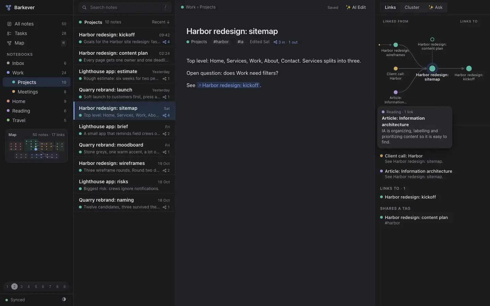

# 0016 Design: C, the linked map

Accepted 2026-10-29 by the owner. Overrides the judge's provisional pick (B).



```
sidebar ──┬ list ─────────┬ editor ──────┬ rail: Links | Cluster | Ask
notebooks │ ● title  ⑂ 4  │ title · tags │ linked from ─► note ─► links to
mini map  │               │ body         │ preview card · shares a tag
```

**Decision.** The app follows prototype C: four columns, notebook colour dots, a link graph rail beside every note, dark mode as the reference look. Tokens come from `reference/prototypes/c-map/src/`.

**Why.** The owner chose it: "that's the path". The judge scored C 66/85, last of four, with the gaps in capture, URL state and organizing. Those are build gaps, not design gaps. We close them with A's capture and sidebar.

**Instead of.** B cards (judge's pick, 69/85), A quiet (71/85), D lanes (68/85). [JUDGE.md](../../reference/prototypes/JUDGE.md)
