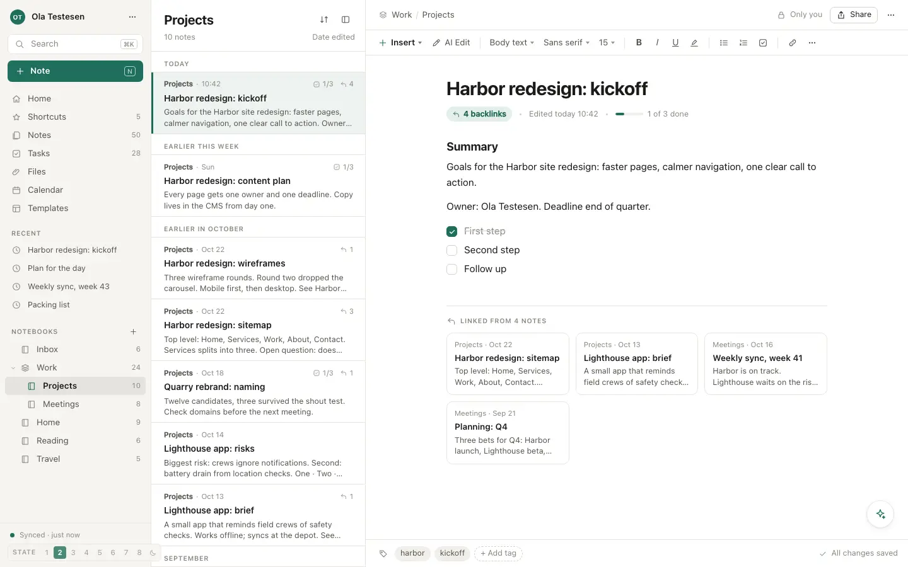

# A · Quiet Evernote

**Idea.** The familiar three panes, made calmer: warm grey sidebar, white list and editor, one moss accent. Every row has the same height and the same three lines.

**Good.** Rows show facts at a glance: checklist progress, backlink count, date groups. Backlinks are preview cards, not a count. AI changes appear as a red/green diff you accept line by line, with undo. A conflict shows both versions side by side and marks what differs. Light and dark both come from one token set.

**Trade-off.** It stays familiar instead of bold. A visual thinker gets tidy text, not pictures: no thumbnails, no canvas.

**With more time.** Image thumbnails in rows, a live ✨ answer instead of a scripted one, real editing in the editor, and a phone screen for each state.

Run: `node build.mjs`, open `index.html`, press 1–8.
