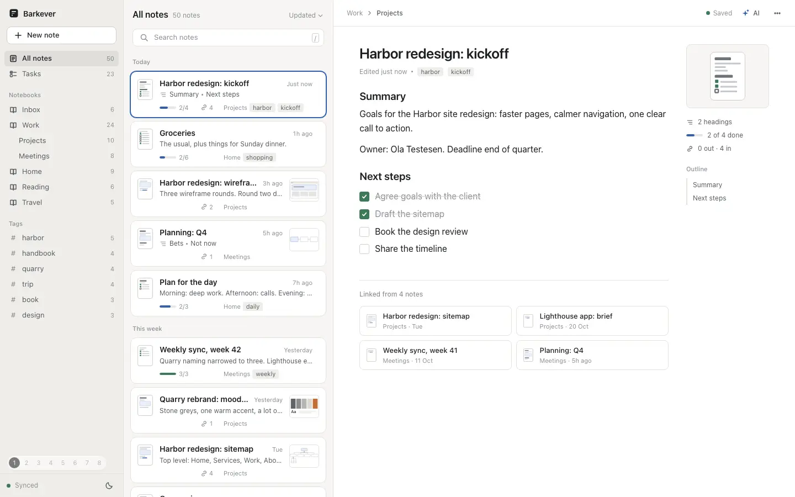

# B · Visual cards

**Idea.** Every card shows the note's shape: a small page silhouette drawn from its blocks (headings, lines, checkboxes, images), then a progress bar, link count, tags and a thumbnail. The same silhouette, larger, sits beside the open note, and again on backlinks, Ask sources and task cards.

**What's good.** One card anatomy, fixed height, facts in fixed columns, so the list reads like a calm table. Color only means something: blue for progress, green for done, red and green for diffs.

**Trade-off.** About 8 cards fit per screen where plain rows fit about 14. The fixtures all share the same shape, so `overlay.mjs` gives 14 checklists their own items and adds headings and 4 diagrams. Without that the silhouettes look alike.

**With more time.** Real image thumbnails, a compact density toggle, drag on the board.
