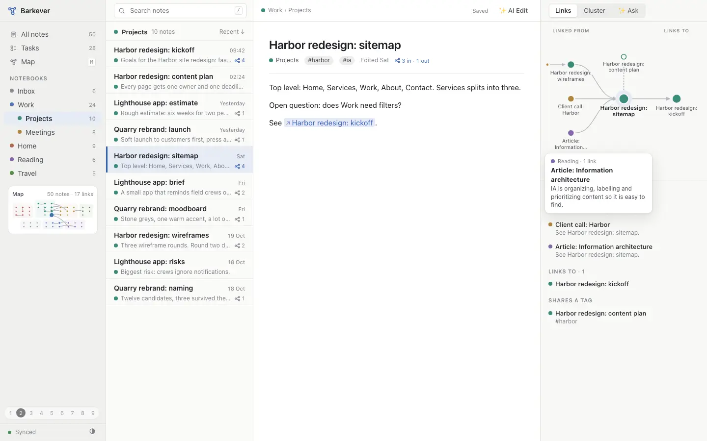

# C · Linked map

**Idea.** Three panes plus a Connections rail. The open note sits in the middle, with notes that link to it on the left, notes it links to on the right, and same-tag notes above and below. Notebooks are tinted areas on one fixed map: a sidebar thumbnail, the Cluster tab, Ask's "where this came from", and full screen (M).

**Good.** You see which way a link points at a glance. The layout never wobbles: click a node and it glides to the centre. AI Edit draws a proposed link as a dashed green edge.

**Trade-off.** The rail takes 340 px from the editor. The grid map stays calm but leaves empty slots, and labels crowd below 0.7× zoom.

**With more time.** `[[` autocomplete, labels that avoid each other, a map that grows with new notes.
