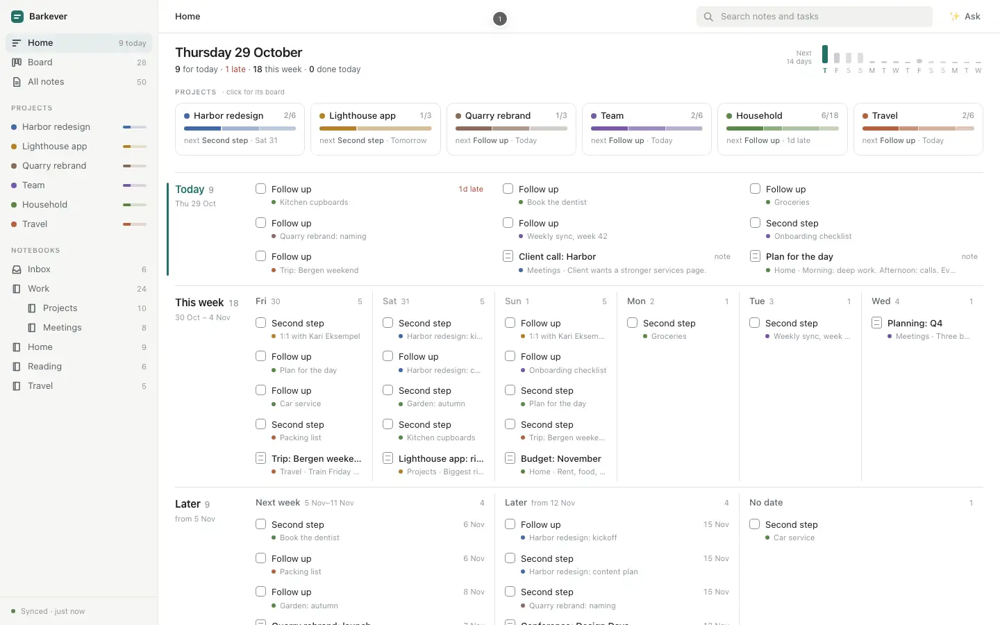

# D · Day lanes and boards

**Idea.** Home sorts work by time: Today, This week (a column per day) and Later. Each row is a checklist line or a dated note. Project tiles show progress; one click opens the project's board, whose columns are Later → This week → Today → Done. Writing uses the usual three panes.

**Good.** One row shape everywhere: lanes, board cards and the note. Tick it anywhere and it changes everywhere. Every card opens its note at its line. Bars show the load per project and per day.

**Trade-off.** Fixture tasks are all "First step", "Second step" or "Follow up", so rows rely on their second line, the note title. At 1440×900, Later is cut off at the bottom.

**With more time.** Drag cards to change dates, add tasks from a lane, set dates in the note, fold Done.

`node build.mjs` joins `src/` and the fixtures into `index.html`.
