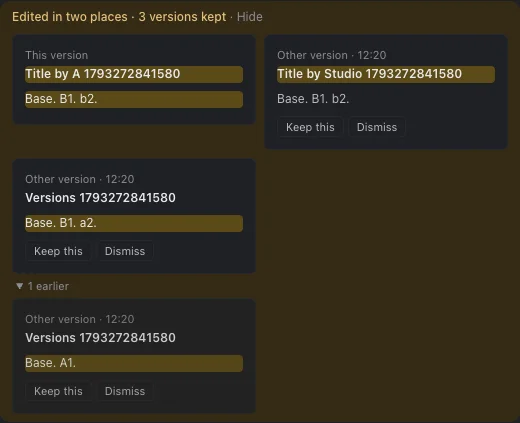

# Spike B: never drop a kept copy



```
merge:   copies = base ∪ mine ∪ theirs (by _key) + theirs' clash copy
drop:    only an exact duplicate: same parts + same text as the main, or as an earlier copy
person:  Keep this ─► copy's clashing parts become the main, copy goes (synced edit)
         Dismiss   ─► copy goes (synced edit, works offline)
view:    one quiet line ─► open ─► This version | one lane per writer+part: latest, "N earlier" folded
```

Closed, the view is one line on the note ([quiet-line-dark.webp](../../docs/img/copy-rule-never-drop/quiet-line-dark.webp)). The list chip counts lanes, not copies.

## Results

| # | Test | Result | Numbers |
|---|---|---|---|
| 1a | Review 5: second offline clash, same block | ✅ | `A1.` kept. Real app: 2 copies by A, 1 lane, earlier folded (on `main`: lost) |
| 1b | Review 5: offline clash, then both type online | ✅ | `A1.`, `a7`, `b7` kept. Real app: **22 stored**, 2 lanes |
| 1c | Review 5: titles, two offline hours | ✅ unit | `Plan A` and `Plan B, a` kept, 1 lane |
| 1d | Two raw writers (Studio, then CLI) | ✅ unit | both kept, 1 lane |
| 2 | Review 4: loser types on main (title, block, offline-vs-online) | ✅ unit ×3, e2e ×2 | losing text on server and both devices |
| 3a | Pile-up: two devices type in one block online for 5 s | ✅ no loss | **52 stored**, 2 shown, 20.9 KB |
| 3b | Pile-up: raw writer sets the title 6× while I type it | ✅ | 6 stored, 1 shown (`Remote title 6`), 2.3 KB |
| 3c | Pile-up: own fast typing | ✅ | **0** |
| 4 | Echo at 0 / 400 / 1200 ms | ✅ | 0 / 0 / 0 copies |
| 5 | J10, incl. "every losing version survives the next edits" | ◐ 2 of 3 runs | Run 1 ✅ 6.0 s, 15 versions on 14 notes. Run 2 ✘ in the offline hour (`client.ts:114`, a create gave no `n=`, before any merge code). Run 3 ✅ 4.4 s, 16 versions |
| 6 | Full e2e | ◐ 55/56, then fixed | `reload-save:168` read `innerText` of the now-folded view; fixed to open it, re-run ✅. In that re-run, "Enter before the editor has loaded" failed; it passed in the full run |
| 6 | `npm run check`, `npm run test`, `tsc` | ✅ | 103 app + 7 mac + 9 repo tests |
| + | New e2e: Keep this, Dismiss, Dismiss offline | ✅ ×2 | `e2e/versions.spec.ts` |
| + | 10-minute two-writer storm (merge level, simulated time) | ✅ no loss, ✗ size | **1138 copies, 1.85 MB**, 2 lanes. `main` rule: 5 copies, 17 KB |
| + | Note size growth | ✗ | ~110 copies and ~185 KB per storm minute; every copy holds the whole body |
| + | Lines changed | | App +129/−24 (8 files). Tests +310/−82, plus `e2e/devices.ts` |

Evidence: `storm.ts`, `storm-b.json`, `storm-main.json`, and `probe/` (run against dataset `probe-b-202610291143`).

## For

- **No loss by rule:** every data-loss repro passes, with no guessing about who typed over whom.
- **Short rule:** copies are only added, and only exact duplicates collapse (in linear time).
- **The person decides:** Keep this and Dismiss are synced edits, so they work offline and merge by key.
- **Calm by default:** one line, one lane per writer and part, older copies folded.

## Against

- **Storage grows with every online clash:** 52 copies in 5 s, 1.85 MB in 10 minutes, and every push sends the whole `conflicts` array.
- **Intermediate keystroke states are kept,** including the writer's own earlier text, which shows as "Your version" (folded).
- **Merge CPU grows with copy count:** about 1 ms per merge at 235 copies.
- **No flag on delete-vs-edit:** a block deleted on one device and edited on another comes back without a flag copy.
- **Old copies wait for a person:** copies from before this rule stay until someone dismisses them.

## Unrun

- Barkpark's document size limit at 1000+ copies.
- Mac app e2e.
- Review 5's title scenario in the real app (unit test only).
